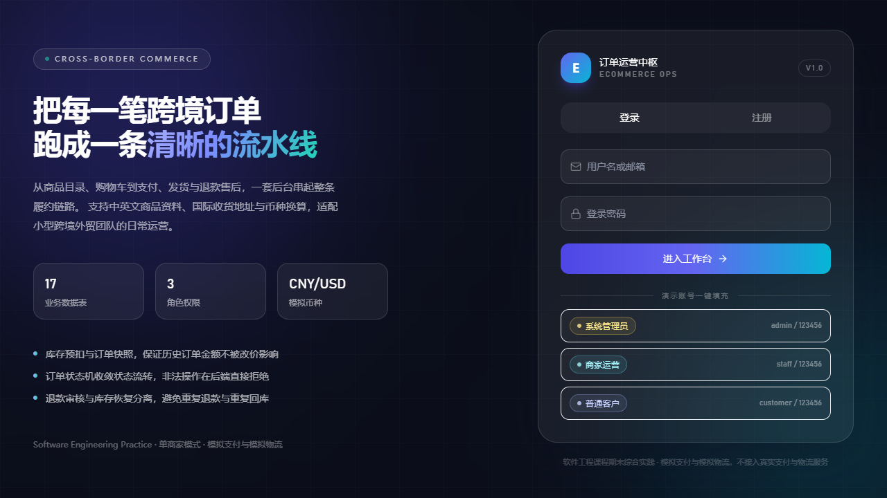
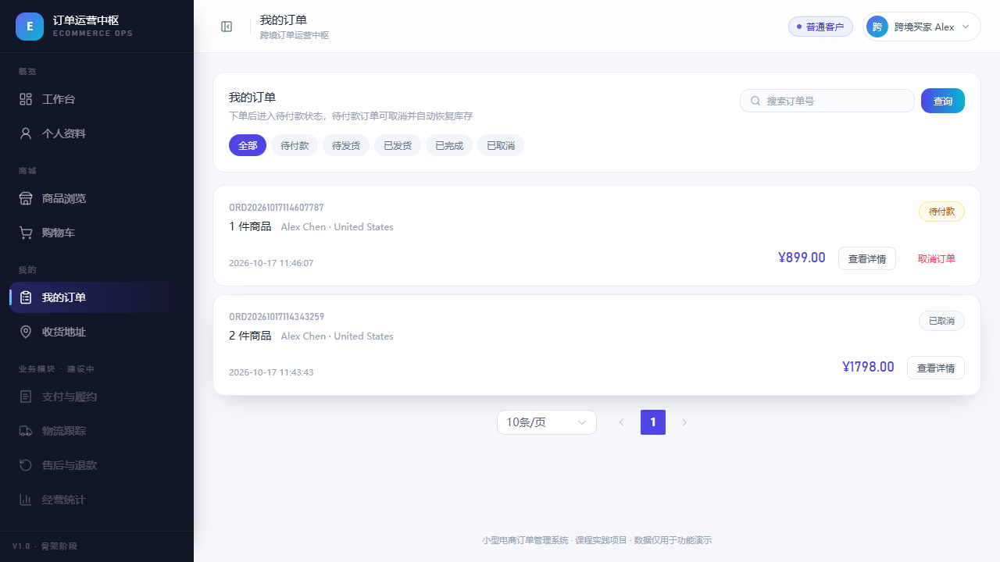
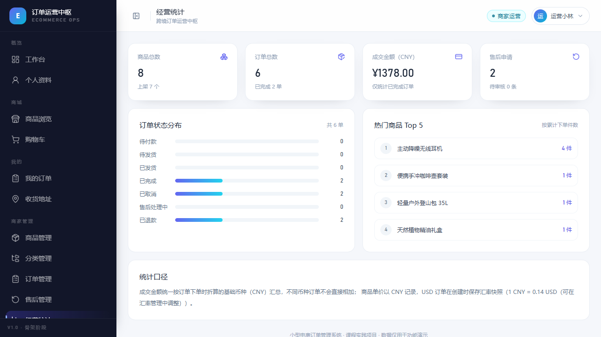
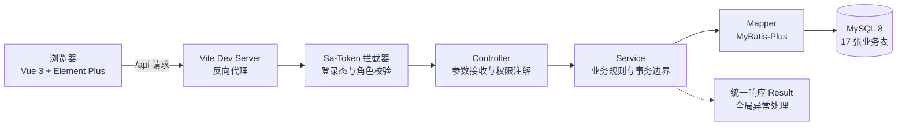
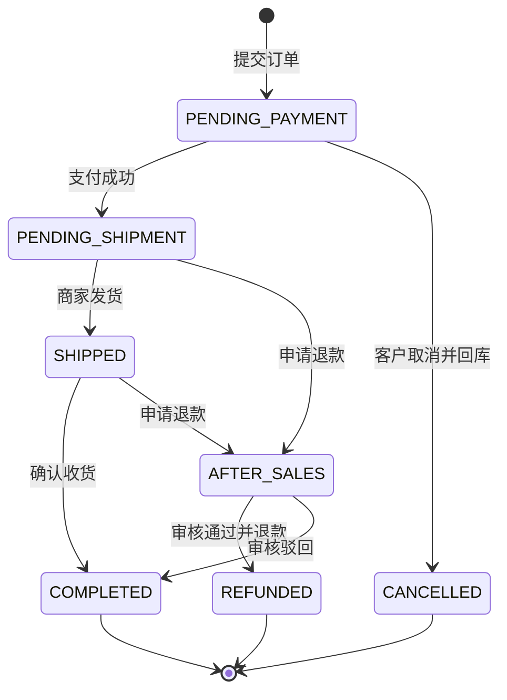

# 小型电商订单系统（跨境贸易场景扩展版）

面向跨境贸易场景的小型电商订单系统，覆盖商品、购物车、订单、支付、物流、售后、评价与经营统计的完整业务链路。软件工程课程期末综合实践项目，六个阶段已全部完成并通过回归验证。


## 目录

- [界面预览](#界面预览)
- [功能概览](#功能概览)
- [快速开始](#快速开始)
- [技术栈](#技术栈)
- [目录结构](#目录结构)
- [配置说明](#配置说明)
- [演示账号](#演示账号)
- [接口清单](#接口清单)
- [权限模型](#权限模型)
- [关键业务规则](#关键业务规则)
- [测试与验证](#测试与验证)
- [验证截图](#验证截图)
- [常见问题](#常见问题)
- [设计取舍与后续规划](#设计取舍与后续规划)
- [开发进度](#开发进度)
- [代码托管](#代码托管)

## 界面预览

<table>
  <tr>
    <td align="center"><br /><sub>登录页（演示账号一键填充）</sub></td>
    <td align="center"><br /><sub>跨境商品目录与分类筛选</sub></td>
  </tr>
  <tr>
    <td align="center"><br /><sub>客户订单列表与状态筛选</sub></td>
    <td align="center"><br /><sub>商家经营统计看板</sub></td>
  </tr>
</table>

全部 23 张验证截图见 [验证截图](#验证截图)。

## 功能概览

系统按三种角色划分功能入口，菜单由前端按角色过滤，权限由后端强制校验。

| 菜单分组 | 功能页面 | ADMIN | STAFF | CUSTOMER |
| -------- | -------- | :---: | :---: | :------: |
| 概览 | 工作台、个人资料 | 是 | 是 | 是 |
| 商城 | 商品浏览、商品详情、购物车、确认订单 | 是 | 是 | 是 |
| 我的 | 我的订单、订单详情、收货地址、售后申请、商品评价 | 是 | 是 | 是 |
| 商家管理 | 商品管理、分类管理、订单管理、售后审核、经营统计 | 是 | 是 | 否 |
| 系统管理 | 用户管理、汇率管理、操作日志 | 是 | 否 | 否 |

跨境贸易场景相对普通电商的扩展点集中在四处。

1. 收货地址支持国家或地区、省州、城市、邮编等国际字段。
2. 商品同时保存中英文名称与描述，便于双语展示。
3. 订单支持 CNY 与 USD 两种结算币种，下单时固化汇率快照。
4. 经营统计统一按 CNY 口径聚合，避免不同币种金额直接相加。

## 快速开始

### 环境要求

| 依赖 | 版本 | 说明 |
| ---- | ---- | ---- |
| JDK | 11 | `JAVA_HOME` 指向 JDK 11，`mvn -v` 输出 `Java version: 11.x` |
| Maven | 3.6+ | 后端构建 |
| Node.js | 18+ | 前端构建，实测 v20.20.2 |
| MySQL | 8.0+ | 字符集 `utf8mb4`，引擎 `InnoDB` |

### 五步启动

以下命令均在仓库根目录执行。

```bash
# 1. 初始化数据库（schema.sql 内含 CREATE DATABASE，可直接执行）
mysql -u root -p < src/database/schema.sql
mysql -u root -p < src/database/seed.sql

# 2. 注入数据库密码（Windows PowerShell 用 $env:MYSQL_PASSWORD="你的密码"）
export MYSQL_PASSWORD="你的密码"

# 3. 启动后端，默认 8080 端口，接口前缀 /api
cd src/backend && mvn spring-boot:run

# 4. 另开终端启动前端
cd src/frontend && npm ci && npm run dev

# 5. 浏览器访问 http://localhost:5173 ，用下方演示账号登录
```

`npm ci` 会严格按 `package-lock.json` 安装，首次拉取依赖时优先用它；需要升级依赖时再改用 `npm install`。

Vite 已将 `/api` 代理到 `http://127.0.0.1:8080`，前端无需额外配置跨域。

## 技术栈

| 层次 | 技术 |
| ---- | ---- |
| 前端 | Vue 3、Vite 5、Element Plus、Pinia、Vue Router、Axios、Tailwind CSS、Lucide 图标 |
| 后端 | Java 11、Spring Boot 2.7.18、MyBatis-Plus 3.5.3.2、Sa-Token 1.37.0、Lombok |
| 数据库 | MySQL 8（InnoDB / utf8mb4） |
| 构建 | Maven 3.6+、npm |

分层职责简述。



## 目录结构

```
ecommerce-system/
├── src/
│   ├── backend/                Spring Boot 后端
│   │   ├── src/main/java/com/ecommerce/
│   │   │   ├── controller/     13 个控制器，仅做参数接收、权限注解与结果包装
│   │   │   ├── service/        业务接口与实现，事务边界所在层
│   │   │   ├── mapper/         数据访问，库存扣减使用条件更新 SQL
│   │   │   ├── entity/         与 17 张业务表一一对应
│   │   │   ├── dto/            入参对象与 javax.validation 校验规则
│   │   │   ├── vo/             出参对象，负责字段组装与脱敏
│   │   │   ├── common/         统一响应、错误码、分页、订单状态机
│   │   │   ├── config/         MyBatis-Plus、Sa-Token、CORS、Jackson、密码编码器
│   │   │   ├── security/       角色数据源与当前登录用户工具
│   │   │   └── exception/      业务异常与全局异常处理
│   │   ├── src/main/resources/ application.yml、application-local.yml.example
│   │   └── src/test/           Maven 约定的 Java 单元测试目录
│   ├── frontend/               Vue 3 前端
│   │   └── src/
│   │       ├── api/            按业务模块拆分的接口封装
│   │       ├── views/          页面，含 admin / orders / shop 子目录
│   │       ├── components/     通用组件
│   │       ├── layouts/        主布局，侧边菜单与顶栏
│   │       ├── router/         路由表与登录、越权守卫
│   │       └── stores/         Pinia 用户状态
│   └── database/               schema.sql 建表脚本、seed.sql 演示数据
├── docs/                       需求、计划、技术栈说明、会议记录与验证截图
├── test/                       课程要求的测试用例与接口回归脚本
│   ├── test-cases/             五个阶段共 127 条功能测试用例
│   └── api/                    smoke.ps1 接口冒烟脚本
├── .gitattributes              统一换行符
├── .gitignore
└── README.md
```

> `src/backend/src/test` 是 Maven 约定的单元测试目录，随工程构建执行；顶层 `test/` 用于存放课程要求的用例文档与接口回归脚本，两者互补。

## 配置说明

数据库密码不写入仓库。任一方式均可提供。

**方式一，环境变量（推荐）**

```bash
# macOS / Linux / Git Bash
export MYSQL_PASSWORD="你的数据库密码"
```

```powershell
# Windows PowerShell
$env:MYSQL_PASSWORD="你的数据库密码"
```

**方式二，本地配置文件**

复制 `src/backend/src/main/resources/application-local.yml.example` 为同目录下的 `application-local.yml` 并填写密码，启动时指定 local 配置：

```bash
cd src/backend && mvn spring-boot:run -Dspring-boot.run.profiles=local
```

`application-local.yml` 已在 `.gitignore` 中排除，不会被误提交。数据库用户名默认 `root`，可用 `MYSQL_USERNAME` 覆盖。

## 演示账号

| 用户名 | 密码 | 角色 | 说明 |
| ------ | ---- | ---- | ---- |
| admin | 123456 | 系统管理员 ADMIN | 用户管理、全量数据查询 |
| staff | 123456 | 商家运营 STAFF | 商品、库存、履约、售后审核 |
| customer | 123456 | 普通客户 CUSTOMER | 浏览下单、支付、售后申请 |

也可用邮箱登录，如 `admin@ecommerce.local`。数据库中仅保存 BCrypt 哈希，不存明文。

## 接口清单

共 48 个接口，统一前缀 `/api`。

<details>
<summary>展开查看完整接口表</summary>

| 方法 | 路径 | 权限 | 说明 |
| ---- | ---- | ---- | ---- |
| POST | `/api/auth/register` | 公开 | 注册普通客户账号（角色固定 CUSTOMER） |
| POST | `/api/auth/login` | 公开 | 用户名或邮箱 + 密码登录，返回 token 与用户信息 |
| POST | `/api/auth/logout` | 登录 | 注销当前登录态 |
| GET | `/api/user/me` | 登录 | 当前用户信息与角色 |
| PUT | `/api/user/profile` | 登录 | 修改昵称、联系电话与国家或地区 |
| GET | `/api/user/page` | ADMIN | 分页查询用户，支持关键字搜索 |
| PUT | `/api/user/status` | ADMIN | 启用 / 禁用账号 |
| GET | `/api/category/tree` | 登录 | 两级分类树 |
| POST | `/api/category` | ADMIN / STAFF | 新增分类 |
| PUT | `/api/category/{id}` | ADMIN / STAFF | 编辑分类 |
| DELETE | `/api/category/{id}` | ADMIN / STAFF | 删除分类（有子分类或商品时拒绝） |
| GET | `/api/product/page` | 登录 | 商品分页与搜索；客户仅能看到上架商品 |
| GET | `/api/product/{id}` | 登录 | 商品详情（含中英文描述与 SKU） |
| POST | `/api/product` | ADMIN / STAFF | 新增商品（可同时提交 SKU 列表） |
| PUT | `/api/product/{id}` | ADMIN / STAFF | 编辑商品与 SKU |
| PUT | `/api/product/{id}/status` | ADMIN / STAFF | 上架 / 下架 |
| DELETE | `/api/product/{id}` | ADMIN / STAFF | 逻辑删除商品 |
| GET | `/api/address/list` | 登录 | 当前用户的收货地址列表 |
| POST | `/api/address` | 登录 | 新增收货地址（首个自动设为默认） |
| PUT | `/api/address/{id}` | 登录 | 编辑地址（校验数据归属） |
| DELETE | `/api/address/{id}` | 登录 | 删除地址（校验数据归属） |
| PUT | `/api/address/{id}/default` | 登录 | 设为默认地址 |
| GET | `/api/cart` | 登录 | 购物车列表，金额与可用性由后端实时计算 |
| POST | `/api/cart/items` | 登录 | 加入购物车（同一商品累加数量） |
| PUT | `/api/cart/items/{id}` | 登录 | 修改数量（校验上架状态与库存） |
| DELETE | `/api/cart/items/{id}` | 登录 | 移出购物车 |
| DELETE | `/api/cart/items` | 登录 | 清空购物车 |
| POST | `/api/order` | 登录 | 从购物车创建订单（后端算价、条件扣库存） |
| GET | `/api/order/page` | 登录 | 订单分页；客户仅能看到自己的订单 |
| GET | `/api/order/{id}` | 登录 | 订单详情（含商品快照与地址快照） |
| PUT | `/api/order/{id}/cancel` | 登录 | 取消待付款订单并恢复库存 |
| POST | `/api/payment/pay` | 登录 | 模拟支付（可模拟成功 / 失败），成功后订单转待发货 |
| GET | `/api/payment/order/{orderId}` | 登录 | 查询订单支付记录 |
| GET | `/api/payment/page` | ADMIN | 管理员分页查询支付记录 |
| POST | `/api/order/{id}/ship` | ADMIN / STAFF | 发货并录入物流公司与单号 |
| GET | `/api/order/{id}/shipment` | 登录 | 查询订单物流信息 |
| POST | `/api/order/{id}/receive` | 登录 | 客户确认收货 |
| POST | `/api/after-sale` | 登录 | 提交整单退款申请 |
| PUT | `/api/after-sale/{id}/audit` | ADMIN / STAFF | 审核退款，通过即执行模拟退款 |
| GET | `/api/after-sale/order/{orderId}` | 登录 | 查询订单的售后单 |
| GET | `/api/after-sale/page` | 登录 | 售后单分页（客户仅能看到自己的） |
| POST | `/api/review` | 登录 | 提交商品评价（仅已完成订单） |
| GET | `/api/review/product/{productId}` | 登录 | 商品评价列表 |
| GET | `/api/review/product/{productId}/summary` | 登录 | 商品评分汇总 |
| GET | `/api/statistics/overview` | ADMIN / STAFF | 经营统计概览 |
| GET | `/api/exchange-rate/list` | 登录 | 汇率列表 |
| PUT | `/api/exchange-rate/{id}` | ADMIN | 调整模拟汇率 |
| GET | `/api/operation-log/page` | ADMIN | 关键操作审计日志 |

</details>

统一响应结构。

```json
{ "code": 200, "message": "操作成功", "data": {} }
```

HTTP 状态码与业务码分离。未登录返回 401，越权返回 403，参数校验失败返回 400，响应体 `code` 为细分业务码。1000 以下沿用 HTTP 语义码，1000 以上为业务码，例如 `1001` 用户名已注册、`1003` 账号或密码错误、`1004` 账号被禁用。

## 权限模型

- 登录态由 Sa-Token 校验，除登录与注册外的所有接口默认需要登录。
- 管理端接口通过 `@SaCheckRole` 在服务端强制校验，前端菜单隐藏只影响体验，不作为权限依据。
- 每次受保护请求都会校验账号状态，被禁用账号即使持有未过期令牌也会被拦截并返回 401。
- 管理员不能禁用自己的账号。
- 业务数据做归属校验，客户访问他人订单、地址、购物车项均返回 403。

## 关键业务规则

### 金额与币种

| 规则 | 说明 |
| ---- | ---- |
| 基础币种 | 商品价格统一以 CNY 记录，商品表 `currency` 字段标记 |
| 订单币种 | 下单时可选 CNY 或 USD，默认 CNY |
| 汇率来源 | 管理员在「汇率管理」维护模拟汇率，不接实时外汇接口 |
| 汇率快照 | 下单时把当时的汇率写入订单 `exchange_rate`，后续调价不影响历史订单 |
| 金额计算 | 商品金额与运费先按 CNY 计算并判断是否包邮（满 500 免运费），再按汇率换算为订单币种 |
| 统计口径 | 统计金额使用订单的 `base_amount`（下单时折算的 CNY 金额），不同币种不直接相加 |

金额一律由后端计算，前端提交的金额参数不采信。商品与地址在下单时固化为快照，后续改价或改地址不影响历史订单。

### 订单状态流转

状态流转集中定义在 `OrderStatus` 枚举中，Service 层不得直接改 `orders.status`。



### 库存一致性

- 下单扣库存使用带条件的原子 `UPDATE ... WHERE stock >= ?`，影响行数为 0 即判定库存不足并回滚整个事务。
- 取消订单通过「订单 ID + 待付款状态」条件更新，保证重复取消只生效一次，避免库存重复回补。
- 每次库存变动都写入 `inventory_logs`，记录变动前后数量、操作人与关联订单。
- 购物车、下单、支付、售后均校验商品上下架状态与所属用户，越权访问直接拒绝。

## 测试与验证

测试分三层，互相补充。

| 层次 | 位置 | 说明 |
| ---- | ---- | ---- |
| Java 单元测试 | `src/backend/src/test/` | JUnit 5 + Spring Boot Test，验证上下文加载、统一响应结构与 BCrypt 校验 |
| 接口回归 | `test/api/smoke.ps1` | 43 项断言，覆盖认证、越权、购物车、下单、支付、发货、收货、评价、售后、统计 |
| 功能测试用例 | `test/test-cases/` | 五个阶段共 127 条用例，含缺陷跟踪 |

```bash
# 单元测试（会加载完整 Spring 上下文，需保证 MySQL 已按 schema.sql 建库）
cd src/backend && mvn test

# 接口回归，需先导入 schema.sql 与 seed.sql 并启动后端
powershell -ExecutionPolicy Bypass -File test/api/smoke.ps1
```

最近一次回归结果，`mvn test` 3/3 通过，`smoke.ps1` 43/43 通过，前端构建成功，浏览器端到端链路通过。

`smoke.ps1` 会真实写入数据，完整走一遍下单、支付、发货、收货、评价、退款申请流程，建议在演示库或测试库执行。可选参数为 `-BaseUrl` 与 `-Password`。

接口层关键验证结论。

- 正确密码登录返回 token 与角色，错误密码返回 400。
- 未携带 token 访问 `/api/user/me` 返回 401。
- 普通客户访问 `/api/user/page` 返回 403。
- 管理员分页查询返回 3 个演示账号。
- 下架商品对客户不可见，对商家仍可见。

## 验证截图

共 23 张，覆盖各阶段关键界面，位于 `docs/screenshots/`。

<details>
<summary>展开查看截图清单</summary>

| 文件 | 内容 |
| ---- | ---- |
| `01-login.png` | 登录页（含演示账号一键填充） |
| `02-dashboard-admin.png` | 管理员工作台与角色菜单 |
| `03-user-management.png` | 管理员用户管理与启停入口 |
| `04-forbidden.png` | 普通客户访问管理员页面被拦截至 403 |
| `05-product-manage.png` | 商家商品管理（8 个演示商品、缺货与上下架状态） |
| `06-category-manage.png` | 两级分类管理 |
| `07-shop.png` | 客户端跨境商品目录与分类筛选 |
| `08-product-detail.png` | 商品详情抽屉（中英文描述与 SKU 规格） |
| `09-address.png` | 国际收货地址管理 |
| `10-cart.png` | 购物车（实时金额与数量调整） |
| `11-checkout.png` | 确认订单（地址选择与金额明细） |
| `12-orders.png` | 我的订单与状态筛选 |
| `13-order-detail.png` | 订单详情与取消入口 |
| `14-order-manage.png` | 商家订单管理 |
| `15-payment.png` | 模拟支付弹窗（含失败分支演示） |
| `16-ship.png` | 商家发货弹窗（物流公司与单号） |
| `17-shipment.png` | 客户查看物流信息与确认收货 |
| `18-refund.png` | 订单退款申请与售后状态 |
| `19-after-sale-audit.png` | 商家售后审核（通过 / 驳回） |
| `20-statistics.png` | 经营统计看板 |
| `21-exchange-rate.png` | 汇率管理 |
| `22-operation-log.png` | 操作审计日志 |
| `23-e2e-regression.png` | 端到端回归（下单→支付→发货→收货全链路） |

</details>

## 常见问题

**Q1 启动后端报 `Access denied for user 'root'`**

数据库密码没有注入。检查 `application-local.yml` 是否存在且密码正确，或启动前设置环境变量 `MYSQL_PASSWORD`。

**Q2 8080 或 5173 端口被占用**

先结束占用进程再启动。

```powershell
Get-NetTCPConnection -LocalPort 8080,5173 -State Listen -ErrorAction SilentlyContinue |
  ForEach-Object { Stop-Process -Id $_.OwningProcess -Force }
```

```bash
# macOS / Linux
lsof -ti:8080,5173 | xargs kill -9
```

**Q3 前端页面能打开但接口 404 或跨域报错**

确认后端已在 8080 运行。Vite 已把 `/api` 代理到 `http://127.0.0.1:8080`，不要直接修改 `baseURL`。

**Q4 `mvn` 用的是 JDK 8 导致编译失败**

`JAVA_HOME` 必须指向 JDK 11 及以上，改完需要重开终端，用 `java -version` 和 `mvn -v` 确认两者一致。

**Q5 演示账号登录提示被禁用**

管理员 `admin` 在「用户管理」中重新启用即可。禁用后该账号的 token 会被后端拦截并返回 401。

**Q6 想恢复初始演示数据**

重新执行 `mysql -u root -p < src/database/seed.sql`，会清空并重建演示数据，不影响表结构。

**Q7 终端里中文输出乱码**

属于代码页问题，不影响数据本身。PowerShell 用户可先执行 `chcp 65001`。

**Q8 `mvn test` 报数据库连接失败**

单元测试会加载完整 Spring 上下文，因此依赖可用的 MySQL。先导入 `schema.sql` 并配置好密码再执行测试。

## 设计取舍与后续规划

当前实现明确为课程范围服务，以下取舍均为有意为之。

| 项目 | 当前实现 | 后续可扩展方向 |
| ---- | -------- | -------------- |
| 支付 | 模拟支付，可指定成功或失败分支 | 接入真实支付网关，补充回调验签与幂等 |
| 汇率 | 管理员手工维护模拟汇率 | 接入行情源，增加定时同步与失效告警 |
| 库存 | 下单即扣减，取消回补 | 增加超时未支付自动关单与延迟队列回补 |
| 订单编号 | 秒级时间戳加随机后缀，受唯一索引保护 | 引入发号器，保证高并发下无需重试 |
| 币种 | 商品价格统一 CNY，币种差异体现在订单 | 支持多基础币种与商品级定价 |
| 许可证 | 暂未添加 | 按课程要求确认后再补充开源许可证 |

## 开发进度

- [x] 阶段一 项目初始化（工程骨架、数据库、统一响应、登录与角色权限）
- [x] 阶段二 商品与客户功能（分类、商品与 SKU、商品浏览筛选、收货地址、个人资料）
- [x] 阶段三 购物车与订单（购物车、下单、库存预扣、订单查询与取消）
- [x] 阶段四 支付与履约（模拟支付、发货、物流跟踪、确认收货）
- [x] 阶段五 售后与扩展功能（退款审核、商品评价、币种汇率、经营统计、操作审计）
- [x] 阶段六 测试、修复与交付（回归 43 项通过、部署说明、代码统计与交付清单）

详细计划见 `docs/plan.md`，需求见 `docs/初始规划.md`，技术选型说明见 `docs/技术栈说明.md`，各阶段评审记录见 `docs/meetings/`，代码规模统计见 `docs/代码统计与交付清单.md`。

## 代码托管

课程要求源码同时托管在头歌平台，仓库地址需填写在报告 4.4 节，评审期间必须可访问。

| 平台 | 地址 | 状态 |
| ---- | ---- | ---- |
| GitHub（开发主仓库） | https://github.com/shayebuhui23/ecommerce-system | 已推送全部提交 |
| 头歌（课程要求仓库） | 待补充 | 期末提交前需推送并填写到报告 4.4 节 |

```bash
# GitHub（开发主仓库）
git push -u origin main

# 头歌（第二个远端，按课程要求补推）
git remote add educoder <头歌仓库地址>
git push educoder main
```

几点约定。

- 头歌的 Git 地址形式为 `https://git.educoder.net/<用户名>/<项目名>.git`，`code.educoder.net/<用户名>/<项目名>` 只是网页地址，不能用于推送。
- `node_modules/`、`dist/`、`target/`、`application-local.yml` 已在 `.gitignore` 中排除，仓库不含依赖、构建产物与数据库密码。
- 后续每次功能完成后提交并推送，保持提交记录连续、均衡，作为过程考核依据。
- 若远端已存在初始 README 等文件，推送前先执行 `git pull --rebase origin main --allow-unrelated-histories` 合并。

## 许可证

仓库暂未添加开源许可证。在补充许可证之前，默认保留所有权利。
