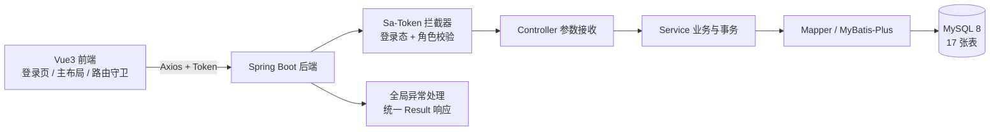

# 小型电商订单系统（跨境贸易场景扩展版）— 骨架搭建开发计划

> 本文档为基于 `docs/初始规划.md` 生成的开发计划，当前阶段目标：**搭建可运行的工程骨架与开发环境**。

## 产品概述

在 `d:/ecommerce-system` 空项目中，按《初始规划.md》从零搭建"小型电商订单系统（跨境贸易场景扩展版）"的可运行工程骨架与开发环境。本次只交付骨架，不实现商品、购物车、订单、支付、物流、售后、评价、统计等业务功能，为后续按规划文档六阶段逐模块开发打好基础。

## 核心功能

- 数据库初始化：一次性建立规划文档第五章列出的 17 张业务表，并写入角色、三个演示账号（客户/商家运营/管理员）、基础分类、基础币种与模拟汇率等骨架必需数据；商品与订单类数据留待后续阶段补充。
- 用户与认证：注册、登录、退出登录、查询当前登录用户信息；密码哈希存储，用户名/邮箱不可重复，普通客户不能自行注册为管理员或商家运营。
- 角色权限控制：普通客户、商家运营、系统管理员三类角色；权限在后端校验（登录态 + 角色权限），未登录或越权访问被拒绝并返回明确错误；管理员可启用/禁用用户，被禁用用户不能执行受保护操作。
- 统一接口规范：REST 风格、JSON 传输、统一成功/失败响应结构、明确的 HTTP 状态码、参数校验失败与业务异常统一处理。
- 前端骨架：登录页、主布局（顶部栏 + 侧边菜单）、基于角色的动态菜单、路由守卫（未登录跳登录页、无权限拦截）、请求统一封装（自动携带凭证、统一错误提示）、登录状态与用户信息持久化。
- 工程与文档：Git 仓库从项目开始建立；README 说明环境要求、建库步骤、启动命令与演示账号；仓库中不包含真实数据库密码。

## 视觉与体验

登录页为独立全屏页面，左侧品牌展示区配合渐变背景与轻量动效，右侧卡片式登录表单，含角色快捷填充演示账号。登录后进入管理后台主布局：深色侧边导航 + 浅色内容区，菜单按登录角色动态渲染，页面切换有过渡动画，表单校验与错误提示统一风格。整体风格现代、干净、有质感，不做玩具化界面。

## 技术栈

严格遵循《初始规划.md》第六章及用户确认：

- 后端：Java 11、Spring Boot 2.7.x、MyBatis-Plus、Sa-Token、MySQL 8.0.44
- 前端：Vue 3、Vite、Element Plus、Pinia、Vue Router、Axios
- 构建：Maven 3.6.3（`maven.compiler.source/target = 11`）
- 环境：Windows 11 + PowerShell；Node v20.20.2 / npm 11.14.1（已实测可用）

注意：本机 JDK 环境现状（2026-10-16 实测核实）——`JAVA_HOME` 已为 `E:\jdk-11.0.0.2`，`java -version`、`javac -version` 与 `mvn -version` 均指向 Java 11.0.0.2，可直接编译目标 11，无需再切换。PATH 中原有的 `E:\jdk 1.8.0_74\bin` 重复项已清理。

`E:\jdk 1.8.0_74` 仍保留在磁盘上，**不要删除**：`E:\springboot_swagger`（Spring Boot 2.0.0.RELEASE）只能用 1.8 构建。若要构建该项目，在该会话中临时设置 `$env:JAVA_HOME = 'E:\jdk 1.8.0_74'` 即可，不需要改回系统级配置。IDEA 中已注册 JDK 11（`File → Project Structure → SDKs` 可直接选用）。

## 实现方案

采用分层单体架构，前后端分离，一次性搭好"可启动、可登录、可鉴权"的最小闭环，业务模块留空位后续填充。

关键决策与理由：

1. **数据库一次建全 17 张表**（`schema.sql`）：避免后续每做一个业务模块都要改库、重构实体，把第五章表结构一次性落定；`seed.sql` 只放骨架必需数据（角色、演示账号、基础分类、币种与汇率），商品/订单等演示数据在对应阶段补充，避免脚本与后续表结构演进互相冲突。
2. **认证与鉴权用 Sa-Token 而非 Spring Security**：规划文档明确指定 Sa-Token，且课程项目规模下 Sa-Token 的注解式鉴权（`@SaCheckRole`、`@SaCheckLogin`）与全局拦截器配置成本更低；密码哈希单独引入 `spring-security-crypto` 或 hutool 的 BCrypt，不引入 Spring Security 全家桶，避免过滤器链带来的额外复杂度。
3. **统一响应与全局异常**：定义 `Result<T>`（code / message / data）作为唯一出参结构，`BusinessException` 承载业务错误码，`@RestControllerAdvice` 统一拦截参数校验异常（`MethodArgumentNotValidException`）、业务异常、Sa-Token 的未登录/无权限异常，映射为明确 HTTP 状态码。这是规划文档 6.4 节与第 9 章"统一处理异常与参数校验、业务逻辑不写在 Controller"的落地方式。
4. **权限校验先落地两层**：本次实现"登录态 + 角色权限"（2.4 节第 1、2 条），"数据归属 + 业务状态"两层校验依赖具体业务模块，在后续阶段随订单/售后模块一并实现，本阶段通过工具方法（取当前登录用户 ID）预留入口。
5. **权限绝不依赖前端隐藏按钮**：前端菜单按角色渲染仅为体验优化，所有接口权限均由后端注解与拦截器强制校验（2.4 节明确要求）。
6. **配置安全**：`application.yml` 的数据库密码使用占位符，由用户本地填写；`.gitignore` 排除本地覆盖配置与构建产物，保证规划文档 9.2 节"不将数据库密码提交到公开仓库"。

性能与可靠性：骨架阶段无热点路径。数据库侧在 `users.username`、`users.email`、业务编号字段建立唯一索引，为后续订单/商品查询预留常用索引；所有金额字段使用 `DECIMAL`，不使用浮点，避免后续跨币种计算出现精度问题。连接池使用 Spring Boot 默认 HikariCP，不引入额外组件。

## 架构设计



分层职责：Controller 只做参数接收与响应封装；Service 承载业务规则、密码哈希与事务；Mapper 负责数据访问；Config 承载 MyBatis-Plus、Sa-Token、CORS 配置；Security 承载鉴权拦截与当前用户获取；Exception 承载业务异常与全局异常处理。

## 实施要点

- **返回结构一致性**：所有接口（含异常路径）必须返回同一 `Result` 结构，前端只需处理一套错误分支。
- **密码安全**：注册与种子数据的密码均存 BCrypt 哈希；演示账号的初始密码在 README 中说明，种子脚本中保存的是哈希而非明文。
- **逻辑删除**：用户等主数据采用 MyBatis-Plus 逻辑删除（`deleted` 标记），与规划文档 5.1 节"删除已产生业务记录的数据应考虑逻辑删除"保持一致。
- **时间字段统一**：`created_at` / `updated_at` 由 MyBatis-Plus 自动填充策略统一维护，避免各模块手工赋值不一致。
- **前端请求封装**：Axios 实例统一注入 Token、统一解析 `Result` 与错误码；401/403 统一处理（跳登录或提示无权限），业务页面不重复写鉴权逻辑。
- **接口契约先行**：会话中的接口路径、请求/响应字段需在实现前固定（如登录、注册、退出、当前用户信息、用户列表与启停），前端按契约开发，避免联调返工。
- **爆炸半径控制**：本次不触碰规划文档中任何业务模块（商品、订单、支付等），仅在骨架中保留 `service` / `mapper` / `entity` 包结构作为扩展位。

## 目录结构

本次为新建工程，完整结构如下（`docs/` 为已有文件）：

```
d:/ecommerce-system/
├── backend/
│   ├── pom.xml                                  # [NEW] Maven 配置：Spring Boot 2.7、MyBatis-Plus、Sa-Token、MySQL 驱动、BCrypt、参数校验；编译目标 Java 11
│   └── src/
│       ├── main/java/com/ecommerce/
│       │   ├── EcommerceApplication.java       # [NEW] 启动类，@MapperScan 扫描 mapper 包
│       │   ├── common/
│       │   │   ├── Result.java                  # [NEW] 统一响应结构 code/message/data，提供 success/fail 静态方法
│       │   │   ├── ResultCode.java              # [NEW] 业务错误码枚举（成功、参数错误、未登录、无权限、业务失败等）
│       │   │   └── PageResult.java              # [NEW] 分页响应包装，供后续模块复用
│       │   ├── config/
│       │   │   ├── MybatisPlusConfig.java       # [NEW] 分页插件与逻辑删除配置
│       │   │   ├── SaTokenConfig.java           # [NEW] 注册 Sa-Token 拦截器，放行登录/注册接口，其余需登录
│       │   │   ├── CorsConfig.java              # [NEW] 开发期跨域配置（允许前端开发端口与自定义请求头）
│       │   │   └── MetaObjectHandlerConfig.java # [NEW] created_at/updated_at 自动填充
│       │   ├── security/
│       │   │   ├── StpInterfaceImpl.java        # [NEW] 实现 Sa-Token 权限接口，按用户 ID 返回角色编码列表
│       │   │   └── LoginUserUtil.java           # [NEW] 获取当前登录用户 ID/角色 的工具方法，为后续数据归属校验预留
│       │   ├── exception/
│       │   │   ├── BusinessException.java       # [NEW] 业务异常，携带 ResultCode 与自定义消息
│       │   │   └── GlobalExceptionHandler.java  # [NEW] @RestControllerAdvice，统一处理参数校验异常、业务异常、未登录/无权限异常、兜底异常
│       │   ├── entity/
│       │   │   ├── User.java                    # [NEW] 用户实体，映射 users 表；字段含用户名、邮箱、密码哈希、状态、逻辑删除标记
│       │   │   └── Role.java                    # [NEW] 角色实体，映射 roles 表
│       │   ├── mapper/
│       │   │   ├── UserMapper.java              # [NEW] UserMapper（继承 BaseMapper），预留按用户名/邮箱查询
│       │   │   └── RoleMapper.java              # [NEW] RoleMapper，预留按用户 ID 查询角色列表
│       │   ├── dto/
│       │   │   ├── RegisterDTO.java             # [NEW] 注册入参，含 @NotBlank/@Email/@Size 校验；不含角色字段，防止提权
│       │   │   ├── LoginDTO.java                # [NEW] 登录入参（用户名/邮箱 + 密码）
│       │   │   └── UserStatusDTO.java           # [NEW] 管理员启用/禁用用户入参
│       │   ├── vo/
│       │   │   ├── LoginVO.java                 # [NEW] 登录响应：token 与用户基本信息
│       │   │   └── UserInfoVO.java              # [NEW] 当前用户信息响应：用户基础字段 + 角色编码列表（不含密码）
│       │   ├── service/
│       │   │   ├── UserService.java             # [NEW] 接口：注册、登录、退出、查询当前用户、分页查询用户、启停用户
│       │   │   └── impl/UserServiceImpl.java    # [NEW] 实现：用户名/邮箱唯一性校验、BCrypt 哈希与校验、登录失败提示不暴露账户细节、禁用用户拦截、事务标注
│       │   └── controller/
│       │       ├── AuthController.java          # [NEW] /api/auth：注册、登录、退出
│       │       └── UserController.java          # [NEW] /api/user：当前用户信息、管理员用户列表(@SaCheckRole ADMIN)、启用/禁用
│       ├── main/resources/
│       │   ├── application.yml                  # [NEW] 数据源（密码留占位符）、MyBatis-Plus、Sa-Token、日志级别配置
│       │   └── application-local.yml.example    # [NEW] 本地覆盖配置示例，供填写真实数据库密码（被 .gitignore 拦截）
│       └── test/java/com/ecommerce/
│           └── EcommerceApplicationTests.java   # [NEW] 上下文启动测试，验证工程可加载
├── frontend/
│   ├── package.json                             # [NEW] Vue3 + Vite + Element Plus + Pinia + Vue Router + Axios 依赖与脚本
│   ├── vite.config.js                           # [NEW] 别名、开发端口、/api 代理到后端
│   ├── index.html                               # [NEW] 应用入口 HTML
│   └── src/
│       ├── main.js                              # [NEW] 应用入口：注册 Element Plus、Pinia、路由、全局样式
│       ├── App.vue                              # [NEW] 根组件
│       ├── api/
│       │   ├── request.js                       # [NEW] Axios 实例：baseURL、请求头注入 Token、统一解析 Result、401/403 统一处理
│       │   └── auth.js                          # [NEW] 认证相关接口封装：登录、注册、退出、获取当前用户
│       ├── stores/
│       │   └── user.js                          # [NEW] Pinia 用户状态：token、用户信息、角色、登录/退出方法；持久化到 localStorage
│       ├── router/
│       │   ├── index.js                         # [NEW] 路由表与路由守卫：未登录跳转登录页、按角色过滤路由、无权限跳 403
│       │   └── routes.js                        # [NEW] 路由与菜单配置（含角色元信息，供侧边菜单渲染）
│       ├── layouts/
│       │   └── MainLayout.vue                   # [NEW] 主布局：顶部栏（用户信息、退出）、侧边菜单、内容区，菜单按角色动态渲染
│       ├── views/
│       │   ├── LoginView.vue                    # [NEW] 登录页（含注册切换与演示账号快捷填充）
│       │   ├── DashboardView.vue                # [NEW] 首屏占位页，展示当前角色与后续模块入口说明
│       │   ├── ProfileView.vue                  # [NEW] 个人资料占位页（展示当前登录信息）
│       │   └── error/403.vue                    # [NEW] 无权限页面
│       ├── components/
│       │   └── RoleTag.vue                      # [NEW] 角色标签组件，登录页与布局复用
│       └── utils/
│           └── auth.js                          # [NEW] token 与用户信息的 localStorage 读写工具
├── database/
│   ├── schema.sql                               # [NEW] 建库 + 17 张表结构：users、roles、categories、products、product_skus、carts、cart_items、addresses、orders、order_items、payments、shipments、after_sales、reviews、inventory_logs、exchange_rates、operation_logs；含主键、唯一约束、DECIMAL 金额、时间字段、索引、逻辑删除列
│   └── seed.sql                                 # [NEW] 初始化数据：三类角色、三个演示账号（BCrypt 哈希）、基础商品分类、CNY/USD 币种与模拟汇率
├── docs/                                        # 已有：初始规划.md 与课程文档
├── .gitignore                                   # [NEW] 排除 target/、node_modules/、dist/、application-local.yml、IDE 配置
└── README.md                                    # [NEW] 环境要求（JDK 11 切换说明）、建库步骤、前后端启动命令、演示账号、接口清单概览
```

## 关键接口契约

本次骨架固定的接口（前端按此实现，避免联调返工）：

- `POST /api/auth/register`：入参 用户名/邮箱/密码/昵称 → 返回注册结果（角色固定为 CUSTOMER）
- `POST /api/auth/login`：入参 账号（用户名或邮箱）/密码 → 返回 `{ token, userInfo }`
- `POST /api/auth/logout`：需登录 → 注销当前登录态
- `GET /api/user/me`：需登录 → 返回当前用户信息与角色编码列表
- `GET /api/user/page`：需 ADMIN 角色 → 分页查询用户列表
- `PUT /api/user/status`：需 ADMIN 角色 → 启用/禁用用户

响应统一为 `{ code, message, data }`。

## 设计风格

面向电商后台管理系统，采用"现代扁平 + 轻玻璃质感"风格：以冷静的蓝紫渐变作为品牌主色，大面积留白与柔和阴影营造专业感，登录页用品牌渐变与光晕背景制造视觉冲击，后台主布局用深色侧边栏与浅色内容区形成清晰层次。组件库沿用项目既定的 Element Plus（规划文档明确指定），在其基础上做主题色与圆角、阴影的统一覆写，避免默认样式观感。

## 应用类型

Web 桌面端后台系统，页面以 1440px 为主设计宽度，向下适配至 1280px，侧边栏在窄屏可折叠。

## 页面规划（本次骨架 4 个页面）

1. **登录页**：全屏左右分栏。左侧品牌区含渐变背景、产品名与跨境场景文案、装饰性光晕与缓慢浮动动效；右侧为居中登录卡片，含账号/密码输入、登录按钮、注册切换、三个演示账号一键填充标签。
2. **主布局（Dashboard 骨架）**：顶部栏含折叠按钮、面包屑、角色标签与用户下拉菜单；侧边菜单按登录角色动态渲染（管理员含用户管理入口，客户/商家仅见基础菜单）；内容区为欢迎卡片与后续模块说明，带淡入上移动画。
3. **个人资料页**：展示当前登录用户的账号、昵称、角色、状态等信息卡片，只读展示，为后续可编辑资料预留结构。
4. **403 无权限页**：居中插画式提示、返回首页按钮，风格与整体一致。

## 交互与动效

- 按钮与卡片悬停有 150-200ms 的位移/阴影/颜色过渡，点击有轻微按压反馈。
- 路由切换使用淡入 + 轻微上移过渡；菜单选中项有左侧高亮条与背景渐变。
- 表单校验错误在输入框下方以主题色提示，登录失败用统一的消息提示组件，不使用浏览器原生弹窗。
- 登录成功后有短暂过渡态，再跳转至首页。

## 响应式

- 内容区使用弹性网格与最大宽度约束，表单宽度固定不随屏幕无限拉伸。
- 侧边栏在宽度不足时自动折叠为图标模式，顶部栏保持可见。
- 登录页在窄屏下改为上下堆叠布局，品牌区简化为顶部条带。

## 开发任务清单（骨架阶段）

| 序号 | 任务 | 依赖 | 状态 |
| ---- | ---- | ---- | ---- |
| 1 | 初始化 Git 仓库与目录结构，编写 `backend/pom.xml`、`application.yml` 与 `database/schema.sql`（17 张表）、`seed.sql`（角色/演示账号/基础分类/币种汇率） | - | 待开始 |
| 2 | 实现后端通用层：`Result` 统一响应、错误码、业务异常、全局异常处理，以及 MyBatis-Plus、Sa-Token、CORS、时间自动填充配置 | 1 | 待开始 |
| 3 | 实现用户与角色实体、Mapper、注册登录退出、BCrypt 密码哈希、角色权限接口与 `/api/auth`、`/api/user` 控制器 | 2 | 待开始 |
| 4 | 搭建前端工程（Vite + Vue3 + Element Plus + Pinia + Router + Axios 封装），实现登录页与注册切换 | 3 | 待开始 |
| 5 | 实现主布局、角色动态菜单、路由守卫、个人资料页与 403 页 | 4 | 待开始 |
| 6 | 编写 README 与建库启动说明，并验证登录、越权拦截与退出流程 | 3、5 | 待开始 |

## 后续阶段（本次不做，按《初始规划.md》推进）

阶段二 商品与客户功能 → 阶段三 购物车与订单 → 阶段四 支付与履约 → 阶段五 售后与扩展功能 → 阶段六 测试、修复与交付。
